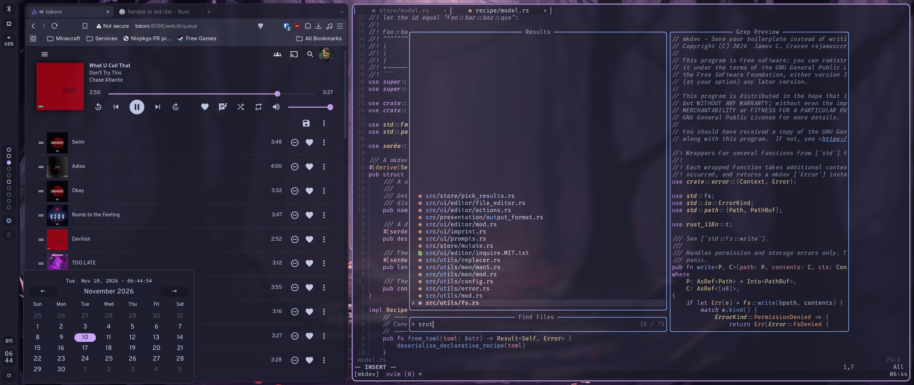
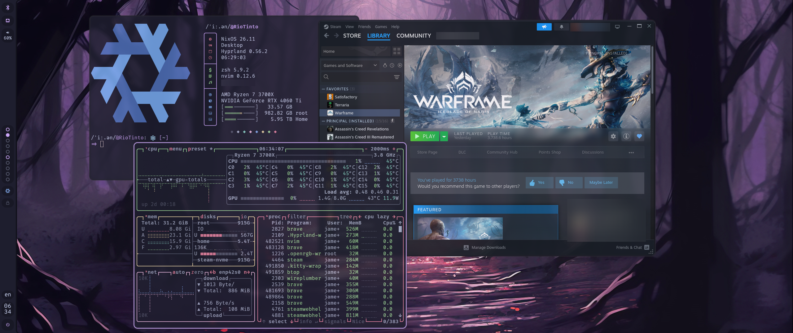

<h1 align="center">
     
     NixOS Configuration Files
     
</h1>

Written and configured with:

Multi-host configuration files for my NixOS machines.

### What is Nix/NixOS?
NixOS is an atomic, declarative, immutable Linux distribution that offers both
rolling and stable releases ([More Info](https://en.wikipedia.org/wiki/NixOS)).
I first tried NixOS in June 2024 and have been daily driving it since around
that time.

Hosts
-----
| Host      | Device Type     | Active | Primary Purpose       |
|-----------|-----------------|--------|-----------------------|
| RioTinto  | Desktop         | 🗹      | Gaming                |
| celebrant | Laptop          | 🗹      | Workstation           |
| tokoro    | Server          | 🗹      | Jellyfin/File Backups |
| wsl       | Virtual Machine | 🗹      | WSL Config            |
| vaal      | Laptop          | ☐      | School                |

Additional Device Info

### Hardware
| Host      | CPU               | MEM  | GPU                |
|-----------|-------------------|------|--------------------|
| RioTinto  | AMD Ryzen 7 3700X | 32GB | NVIDIA RTX 4060 Ti |
| celebrant | AMD Ryzen 7 7730U | 16GB | Integrated         |
| tokoro    | Intel i7-4790K    | 32GB | Integrated         |

### Graphical Environment
| Host      | WM/DE    | DM       |
|-----------|----------|----------|
| RioTinto  | Hyprland | Cosmic   |
| celebrant | Hyprland | Ly       |
| tokoro    | headless | headless |

### Device Namesake
In my house we've always named our machines after rivers. These are the rivers that
inspired each host:
| Host      | Namesake                                                                                 |
|-----------|------------------------------------------------------------------------------------------|
| RioTinto  | [Rio Tinto, Spain](https://en.wikipedia.org/wiki/Rio_Tinto_(river))                      |
| celebrant | [Celebrant, Middle Earth](https://lotr.fandom.com/wiki/Celebrant)                        |
| tokoro    | [Tokoro River, Japan](https://en.wikipedia.org/wiki/Tokoro_River)                        |
| wsl       | [Windows Subsystem for Linux](https://en.wikipedia.org/wiki/Windows_Subsystem_for_Linux) |
| vaal      | [Vaal River, South Africa](https://en.wikipedia.org/wiki/Vaal_River)                     |

Screenshots
-----------

<i>Screenshots taken on RioTinto.</i>

Config Structure
----------------
I strive not to use any external libraries or frameworks to organise my
configuration. Where and when possible, I use vanilla Nix+Flakes, and if
there's a functionality I lack, I try to implement it myself with nixpkgs's
standard library. To that end, there are several tools/organisation techniques
I employ:

### Traits
I compose my systems from a combination of Nix modules that I call "traits"
(taken from the Rust terminology).

[Traits Documentation](./docs/traits.md)

### Custom Library and Config Options
For both `lib` and `options`, I have custom extensions under the attribute
`ext`. I don't have proper external documentation for them because, well,
they're for me, but the library itself can be found [here](./lib/default.nix).
As for the custom options, some are [here](./modules/constants) and the
rest are spread about my traits.

Do note that the lib, like the rest of this flake is licensed `GPL-3.0-or-later`.
If you want to use it (and your config is publicly available), it must _also_
be licensed this way. (See also: [full license text](./LICENSE))

### Style Guide
In addition to a [treefmt config](./overlay/formatter.nix), I use a specific
format for comments to help make the purpose of a file clear, and to give it a
clearer visual hierarchy in a standardised way.

[Style Documentation](./docs/style.md)

#### LLM Disclosure
This repo is **not** vibe-coded. Every line, every character was manually
inserted by me, my LSP, or a snippet I wrote. I do _consult_ LLMs when I can't
figure something out, much as I consult the manual or Google, but I don't copy
and paste code.

#### Acknowledgements
Much of the general structure of this repo is heavily inspired by, or in some
cases ripped directly from [isabelroses's
dotfiles](https://github.com/isabelroses/dotfiles). Her work is a huge
inspiration of mine, and I would be remiss in failing to make mention of it.

My friend [Steven](https://github.com/Steven-S1020/Nixos-Configuration) and I
also copy each other's notes a lot (him more than me /j), and much of my work
was encouraged or directly inspired by him and his workflow as well.
